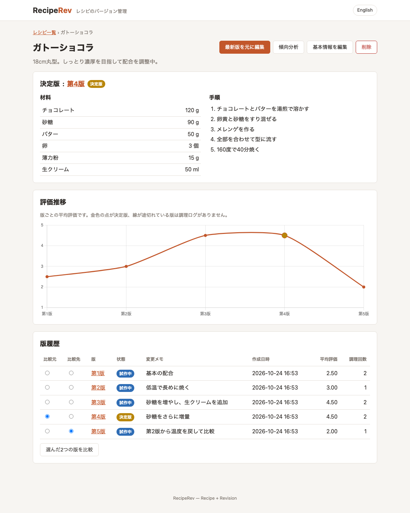
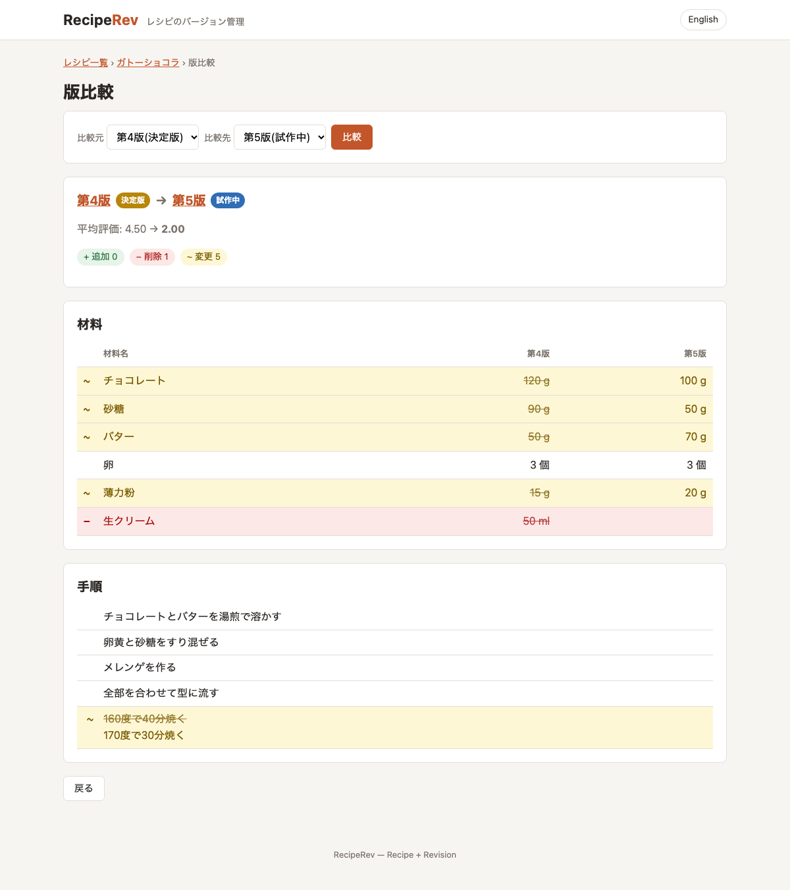
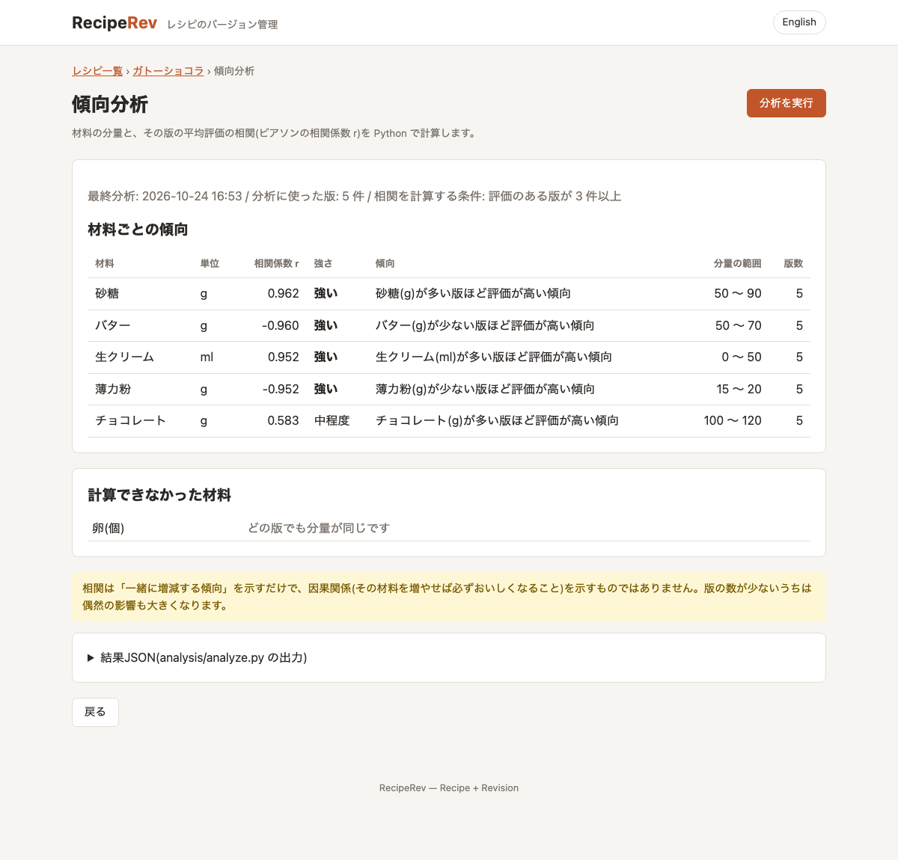

# RecipeRev

[English](README.md) | [日本語](README.ja.md)

**RecipeRev**(Recipe + Revision)は、レシピのバージョン管理Webアプリです。レシピを調整するたびに新しい版を記録し、任意の2版を並べて比較し、調理結果を記録して「一番おいしい配合」を探せます。



## コンセプト

料理は試行錯誤の連続です。砂糖を少し減らす、醤油を少し足す、加熱時間を変える。RecipeRevは、レシピを「変更履歴・差分表示・承認フローを持つ管理対象」として扱い、何を変えたのか、それで良くなったのかを確認できるようにします。

このプロジェクトはポートフォリオでもあります。産業系の「レシピ管理」システムに典型的な構造(変更履歴・差分・承認)を身近な題材で再現し、要件定義・設計・開発・テスト・リリースの全工程を成果物として残しています。

| 業務システムのレシピ管理 | RecipeRev |
| --- | --- |
| プロセスレシピのリビジョン | レシピの版(後から書き換えない記録) |
| パラメータ | 版ごとの材料・分量 |
| 承認済みの量産レシピ | 決定版(レシピごとに1つだけ。DBの制約でも保証する) |
| 歩留まり・品質データ | 調理ログ・評価 |
| パラメータと歩留まりの分析 | Python による相関分析 |

## 主な機能

- **レシピ管理**: レシピの登録・編集・論理削除(名前、説明、材料と分量、手順)
- **自動バージョン管理**: 材料・手順を保存すると、後から書き換えない新しい版を作成(どの過去の版からでも派生できる)。変更がない保存は受け付けない
- **差分表示**: 任意の2版を選び、追加(緑 `+`)・削除(赤 `−`)・変更(黄 `~`)を材料・分量・手順ごとに色付きで表示。手順は行単位で LCS(最長共通部分列)を使って比較する
- **承認フロー**: `下書き` -> `試作中` -> `決定版`。決定版はレシピごとに1つだけ。新しい決定版を選ぶと、以前の決定版は同じトランザクションの中で「試作中」に戻る
- **調理ログ**: 調理日、評価(1〜5)、味メモ、写真(1枚)を版に紐づけて記録。下書きの版は自動で試作中になる
- **評価推移グラフ**: 版ごとの平均評価を Chart.js の折れ線グラフで表示(決定版を強調し、ログのない版は線を切る)
- **傾向分析**: Pythonスクリプトで材料の分量と評価の相関を分析し(例: 「砂糖が多い版ほど高評価」)、結果を画面に表示
- **英語・日本語の切り替え**: 画面は英語が既定で、ヘッダーのボタンで日本語に切り替えられる(Cookie に保存)。画面の文言・入力エラー・エラーメッセージはすべて `messages.properties` / `messages_ja.properties` に置いている

| 版比較(差分) | 傾向分析 |
| --- | --- |
|  |  |

## 技術スタック

| 領域 | 技術 |
| --- | --- |
| バックエンド | Java 21, Spring Boot 3.5, Spring MVC, Spring Data JPA, JdbcClient, Bean Validation, Flyway, MessageSource(多言語対応), Maven |
| フロントエンド | Thymeleaf, 素のJavaScript, Chart.js 4, HTML/CSS |
| データベース | MySQL 8.4(Docker Compose) |
| 分析 | Python 3.15.1 + pandas 3。[uv](https://docs.astral.sh/uv/) で管理(`analysis/pyproject.toml`、`uv.lock`) |
| テスト | JUnit 5, AssertJ, Spring Boot Test, MockMvc, Testcontainers(MySQL), Python unittest |

## アーキテクチャ

```
ブラウザ ──▶ controller ──▶ service ─────────────▶ repository ──▶ MySQL 8.4
 (Thymeleaf,   (MVC, PRG,     (@Transactional,      (CRUDはJPA、
  Chart.js)     入力検証)       業務ルール,           集計・差分SQLは
                               RecipeDiffService)    JdbcClient)
                                    │
                                    └─ ProcessBuilder ─▶ analysis/analyze.py(CSVを入力、JSONを出力)
```

- レイヤー構成のパッケージ: `controller` / `service` / `repository` / `domain` / `dto`(+ `config`, `exception`)
- `RecipeDiffService` は DB にも HTTP にも依存しないクラスにして、単体テストで検証
- トランザクション境界はservice層に配置。版番号は `SELECT ... FOR UPDATE` でロックしてから採番する
- 業務ルールは、ドメイン/サービスのコードと DB の制約の2か所で守る
- 入力検証はBean Validation。例外は `@ControllerAdvice`(HTML)と `@RestControllerAdvice`(ProblemDetail の JSON)で集約
- Python分析はアプリから疎結合: Java が CSV を書き出し、スクリプトを `uv run` でバッチとして実行し、出力された JSON を読む
- 多言語対応: `CookieLocaleResolver`(既定は英語。ブラウザの `Accept-Language` は見ない)+ `LocaleChangeInterceptor`(`?lang=ja` / `?lang=en`)。例外は文言ではなく「メッセージキー + 引数」(`MessageSourceResolvable`)を持ち、表示する時点で利用者の言語に変換する

## データベース

| テーブル | 役割 |
| --- | --- |
| `recipes` | レシピ本体(`deleted_at` で論理削除) |
| `recipe_versions` | 版番号、状態、手順、変更メモ、派生元の版 |
| `version_ingredients` | 版ごとの材料と分量 |
| `cook_logs` | 版ID、評価、メモ、調理日、写真パス |

主な制約:

- `UNIQUE (recipe_id, version_no)`: 版番号を重複させない
- 決定版は1レシピ1件まで: MySQL には条件付きの一意インデックスがないため、**生成列** `final_marker = IF(status='FINAL', recipe_id, NULL)` に `UNIQUE` を付ける(NULL どうしは重複とみなされない)
- 状態と評価(1〜5)の `CHECK` 制約

ER図(Mermaid)・制約・版を比較するSQL(`FULL OUTER JOIN` を使わない差分、NULL でも正しく比べられる `<=>`、分析用の表を作る CTE + `CROSS JOIN`)は [docs/04_er_diagram.md](docs/04_er_diagram.md) を参照してください。

## セットアップ

### 前提

- JDK 21
- Docker / Docker Compose
- [uv](https://docs.astral.sh/uv/)(傾向分析を使う場合のみ)。初めて分析を実行したときに、uv が `uv.lock` どおりに Python 3.15.1 と pandas を `analysis/.venv` に用意します。前もって用意する場合は `uv sync --project analysis`

### 起動

```bash
# 1. クローン
git clone https://github.com/shim369/Java-RecipeRev-App.git
cd Java-RecipeRev-App

# 2. MySQLを起動
docker compose up -d

# 3. アプリを起動(初回起動時に Flyway がテーブルを作成します)
./mvnw spring-boot:run

# サンプルデータ付きで起動する場合(レシピ2件、版7件、調理ログ)
./mvnw spring-boot:run -Dspring-boot.run.profiles=demo
# サンプルデータを日本語にする場合
./mvnw spring-boot:run -Dspring-boot.run.profiles=demo -Dspring-boot.run.arguments=--reciperev.demo.locale=ja
```

起動後、http://localhost:8080 を開いてください。画面は英語で表示されます。右上の「日本語」ボタンで日本語に切り替えられます。

- コマンドはリポジトリ直下で実行してください。写真は `uploads/`、分析ファイルは `analysis/output/` に、そこからの相対パスで保存されます。
- DB の接続設定の初期値は `docker-compose.yml` と同じです。変更する場合は `.env.example` を `.env` にコピーし(Docker Compose が読み込みます)、アプリにも同じ環境変数を設定してください。

### テストの実行

```bash
./mvnw test                                          # Java 77件(Testcontainers を使うため Docker が必要)
uv run --project analysis python -m unittest discover -s analysis/tests -v    # Python 10件
```

## ディレクトリ構成

```
Java-RecipeRev-App/
├── docs/                    # 要件定義、画面一覧、画面遷移、ER図、テスト仕様書、スクリーンショット
├── analysis/                # Pythonによる傾向分析(uv プロジェクト: analyze.py、テスト、pyproject.toml、uv.lock)
├── src/
│   ├── main/java/com/shim369/reciperev/
│   │   ├── controller/      # MVC コントローラ、JSON API、例外ハンドラ
│   │   ├── service/         # ユースケース、RecipeDiffService、写真保存、分析の実行
│   │   ├── repository/      # Spring Data JPA と JdbcClient の SQL
│   │   ├── domain/          # エンティティ、値オブジェクト、差分モデル
│   │   ├── dto/             # フォーム、画面表示用のモデル
│   │   ├── config/          # 型付きの設定値、多言語対応(ロケール)、デモデータ
│   │   └── exception/
│   ├── main/resources/
│   │   ├── db/migration/    # Flyway の SQL
│   │   ├── templates/       # Thymeleaf
│   │   ├── messages*.properties  # 画面の文言(英語が既定 / 日本語)
│   │   └── static/          # CSS、JavaScript
│   └── test/java/           # 単体テスト・結合テスト
├── docker-compose.yml
├── pom.xml
├── README.md
└── README.ja.md
```

## ドキュメント

| ドキュメント | 内容 |
| --- | --- |
| [01 要件定義書](docs/01_requirements.md) | 目的、用語集、機能要件、業務ルール、非機能要件 |
| [02 画面一覧](docs/02_screens.md) | 画面一覧、URL、表示項目、操作、JSON API |
| [03 画面遷移図](docs/03_screen_flow.md) | 画面遷移図、主なシナリオ |
| [04 ER図・テーブル定義](docs/04_er_diagram.md) | ER図、テーブル定義、制約、版を比較するSQL |
| [05 テスト仕様書](docs/05_test_spec.md) | 単体・結合・Python・手動テストのケースと結果 |

## ロードマップ

- [x] Phase 1: 要件定義、画面一覧、画面遷移、ER図(`docs/`)
- [x] Phase 2: プロジェクト雛形、Docker Compose、レシピCRUD
- [x] Phase 3: バージョン管理、差分表示、承認フロー
- [x] Phase 4: 調理ログ(写真含む)、評価推移グラフ
- [x] Phase 5: Python傾向分析の連携
- [x] Phase 6: 単体・結合テスト、テスト仕様書、ドキュメント整備
- [x] 英語を既定とした画面と日本語への切り替え

今後の拡張案: Spring Security によるログインと2段階承認(申請者と承認者を分ける)、状態変更の履歴、材料マスタによる表記ゆれ対策、複数の材料を同時に考慮した回帰分析。

## ライセンス

このプロジェクトは [MIT License](LICENSE) のもとで公開されています。
