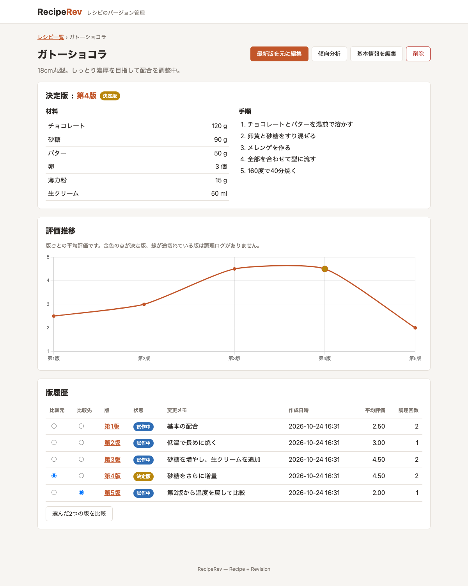
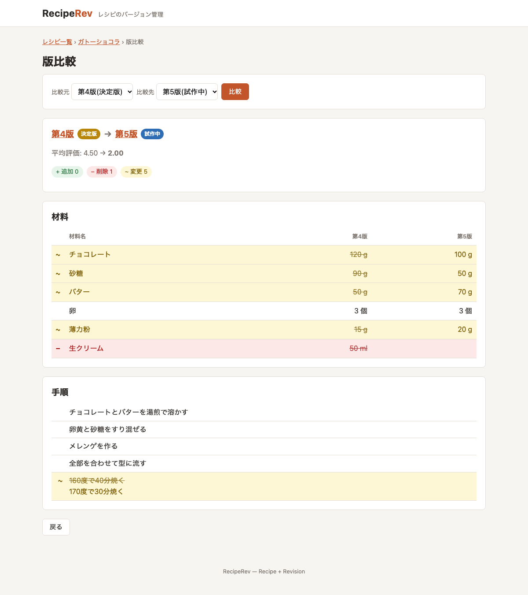
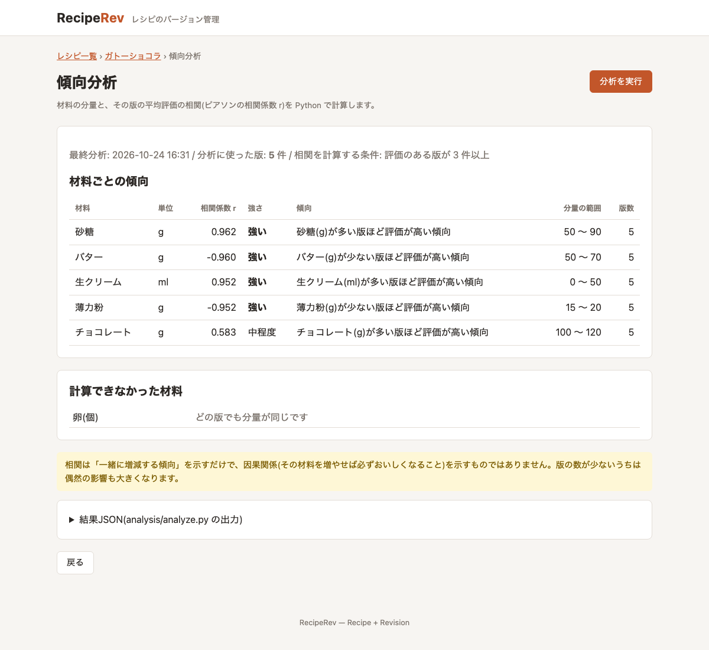

# RecipeRev

[English](README.md) | [日本語](README.ja.md)

**RecipeRev** (Recipe + Revision) is a recipe version-control web app. Every time you tweak a recipe, a new version is recorded. Compare any two versions side by side, log how each attempt turned out, and find the formulation that tastes best.



## Concept

Cooking is iterative: a little less sugar, a bit more soy sauce, a different cooking time. RecipeRev treats each recipe like a managed document with a revision history, a diff view, and an approval flow, so you can see exactly what changed and whether it made the dish better.

This project is also a portfolio piece. It reproduces the typical shape of an industrial "recipe management" system (change history, diff, approval) with an everyday subject, and keeps the full development process (requirements, design, implementation, testing, release) as documented deliverables.

| Industrial recipe management | RecipeRev |
| --- | --- |
| Process recipe revision | Recipe version (immutable snapshot) |
| Parameters | Ingredients and amounts per version |
| Approved production recipe | `Final` version (exactly one per recipe, enforced by the DB) |
| Yield / quality data | Cooking logs and ratings |
| Parameter vs. yield analysis | Python correlation analysis |

## Features

- **Recipe management**: create, edit, and soft-delete recipes (name, description, ingredients with quantities, steps)
- **Automatic versioning**: saving ingredients/steps creates a new immutable version (any past version can be the base); saving without changes is rejected
- **Diff view**: pick any two versions and see added (green, `+`), removed (red, `−`), and changed (yellow, `~`) ingredients, quantities, and steps (line-based LCS)
- **Approval flow**: `Draft` -> `Trial` -> `Final`. Only one Final version per recipe; promoting a new one moves the previous Final back to Trial in the same transaction
- **Cooking log**: record date, rating (1-5), taste notes, and one photo per attempt, linked to a version (a Draft version becomes Trial automatically)
- **Rating chart**: average rating per version as a Chart.js line chart (Final highlighted, gaps for versions without logs)
- **Trend analysis**: a Python script computes the correlation between ingredient quantities and ratings (for example, "versions with more sugar tend to score higher") and the result is shown in the UI

| Diff view | Trend analysis |
| --- | --- |
|  |  |

## Tech Stack

| Area | Technology |
| --- | --- |
| Backend | Java 21, Spring Boot 3.5, Spring MVC, Spring Data JPA, JdbcClient, Bean Validation, Flyway, Maven |
| Frontend | Thymeleaf, vanilla JavaScript, Chart.js 4, HTML/CSS |
| Database | MySQL 8.4 (via Docker Compose) |
| Analysis | Python 3.9+ with pandas (`analysis/`) |
| Testing | JUnit 5, AssertJ, Spring Boot Test, MockMvc, Testcontainers (MySQL), Python unittest |

## Architecture

```
Browser ──▶ controller ──▶ service ──────────────▶ repository ──▶ MySQL 8.4
  (Thymeleaf,   (MVC, PRG,    (@Transactional,       (JPA for CRUD,
   Chart.js)     validation)   business rules,        JdbcClient for
                               RecipeDiffService)     aggregate / diff SQL)
                                    │
                                    └─ ProcessBuilder ─▶ analysis/analyze.py (CSV in, JSON out)
```

- Layered packages: `controller` / `service` / `repository` / `domain` / `dto` (+ `config`, `exception`)
- `RecipeDiffService` is a pure class with no DB/HTTP dependency, covered by unit tests
- Transaction boundaries live in the service layer; version numbering uses `SELECT ... FOR UPDATE`
- Business rules are enforced twice: in the domain/service code and by DB constraints
- Input validation with Bean Validation; exceptions handled centrally via `@ControllerAdvice` (HTML) and `@RestControllerAdvice` (ProblemDetail JSON)
- Python analysis is decoupled from the app: Java exports CSV, runs the script as a batch job, and reads JSON

## Database

| Table | Purpose |
| --- | --- |
| `recipes` | Recipe master (soft delete with `deleted_at`) |
| `recipe_versions` | Version number, status, steps, change note, base version |
| `version_ingredients` | Ingredients and amounts per version |
| `cook_logs` | Version ID, rating, notes, cooked date, photo path |

Key constraints:

- `UNIQUE (recipe_id, version_no)`: no duplicate version numbers
- At most one `FINAL` per recipe: MySQL has no partial index, so a **stored generated column** `final_marker = IF(status='FINAL', recipe_id, NULL)` carries a `UNIQUE` index (NULLs don't collide)
- `CHECK` constraints for status and rating (1-5)

See [docs/04_er_diagram.md](docs/04_er_diagram.md) for the ER diagram (Mermaid), constraints, and the version-comparison SQL (diff without `FULL OUTER JOIN`, null-safe `<=>`, CTE + `CROSS JOIN` for the analysis matrix).

## Getting Started

### Prerequisites

- JDK 21
- Docker and Docker Compose
- Python 3.9+ with pandas (only for trend analysis): `python3 -m pip install -r analysis/requirements.txt`

### Run

```bash
# 1. Clone
git clone https://github.com/shim369/Java-RecipeRev-App.git
cd Java-RecipeRev-App

# 2. Start MySQL
docker compose up -d

# 3. Start the app (Flyway creates the tables on first start)
./mvnw spring-boot:run

# Optional: start with sample data (2 recipes, 7 versions, cooking logs)
./mvnw spring-boot:run -Dspring-boot.run.profiles=demo
```

Then open http://localhost:8080.

- Run the commands from the repository root: photos are saved to `uploads/` and analysis files to `analysis/output/` relative to it.
- DB settings default to the values in `docker-compose.yml`. To change them, copy `.env.example` to `.env` (used by Docker Compose) and export the same variables for the app.

### Run tests

```bash
./mvnw test                                          # 71 Java tests (Docker required for Testcontainers)
python3 -m unittest discover -s analysis/tests -v    # 10 Python tests
```

## Project Structure

```
Java-RecipeRev-App/
├── docs/                    # requirements, screens, screen flow, ER diagram, test spec, screenshots
├── analysis/                # Python trend analysis (analyze.py, tests, requirements.txt)
├── src/
│   ├── main/java/com/shim369/reciperev/
│   │   ├── controller/      # MVC controllers, JSON API, exception handlers
│   │   ├── service/         # use cases, RecipeDiffService, photo storage, analysis runner
│   │   ├── repository/      # Spring Data JPA + JdbcClient SQL
│   │   ├── domain/          # entities, value objects, diff model
│   │   ├── dto/             # forms and read models
│   │   ├── config/          # typed properties, demo data
│   │   └── exception/
│   ├── main/resources/
│   │   ├── db/migration/    # Flyway SQL
│   │   ├── templates/       # Thymeleaf
│   │   └── static/          # CSS, JavaScript
│   └── test/java/           # unit + integration tests
├── docker-compose.yml
├── pom.xml
├── README.md
└── README.ja.md
```

## Documents

| Document | Contents |
| --- | --- |
| [01 Requirements](docs/01_requirements.md) | Purpose, glossary, functional requirements, business rules, non-functional requirements |
| [02 Screens](docs/02_screens.md) | Screen list, URLs, items, actions, JSON API |
| [03 Screen flow](docs/03_screen_flow.md) | Screen transition diagram and main scenarios |
| [04 ER diagram](docs/04_er_diagram.md) | ER diagram, table definitions, constraints, comparison SQL |
| [05 Test spec](docs/05_test_spec.md) | Unit / integration / Python / manual test cases and results |

(Design documents are written in Japanese.)

## Roadmap

- [x] Phase 1: Requirements, screen list, screen transitions, ER diagram (`docs/`)
- [x] Phase 2: Project setup, Docker Compose, recipe CRUD
- [x] Phase 3: Versioning, diff view, approval flow
- [x] Phase 4: Cooking log (with photo), rating chart
- [x] Phase 5: Python trend analysis integration
- [x] Phase 6: Unit/integration tests, test specifications, documentation

Future ideas: login and two-step approval (requester / approver) with Spring Security, status change history, ingredient master for spelling variations, multi-variable regression.

## License

This project is licensed under the [MIT License](LICENSE).
