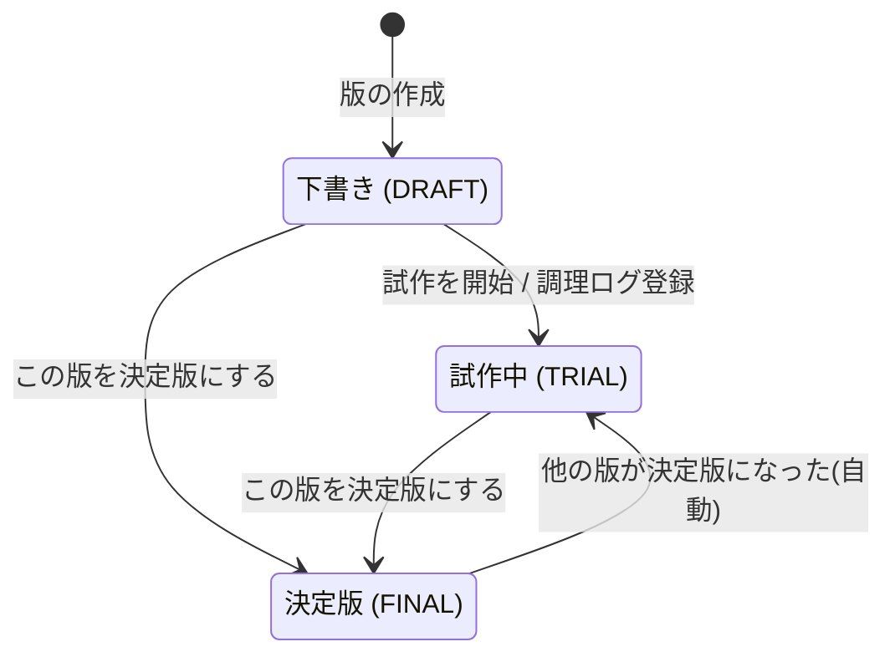

# 01. 要件定義書 — RecipeRev

| 項目 | 内容 |
|---|---|
| ドキュメント | 要件定義書 |
| 対象システム | RecipeRev(Recipe + Revision) |
| 版 | 1.0 |
| 作成日 | 2026-10-24 |
| ステータス | Phase 1 レビュー待ち |

関連ドキュメント: [02_画面一覧](02_screens.md) / [03_画面遷移図](03_screen_flow.md) / [04_ER図・テーブル定義](04_er_diagram.md)

---

## 1. 目的と背景

### 1.1 目的
料理の配合(材料・分量)や手順を変更するたびに **版(バージョン)** を記録し、
**前版との差分** と **調理評価** を見比べることで「一番うまくいった配合」を見つけられるようにする。

### 1.2 背景
製造業(例: 半導体製造装置)の「レシピ管理」業務では、以下が重要になる。

- 条件(レシピ)の **変更履歴** を必ず残し、過去の版を改ざんしない
- 版同士の **差分** を確認してから適用する
- 量産に使う条件は **承認済みの1版だけ** に限定する
- 実績データ(歩留まり等)と条件の **相関** を分析し、改善につなげる

RecipeRev は、この業務システムの型を「家庭の料理レシピ」という身近な題材で再現するポートフォリオである。

| 業務システムの概念 | RecipeRev での対応 |
|---|---|
| プロセスレシピ | レシピ |
| レシピのリビジョン | 版(recipe_versions) |
| パラメータ | 材料・分量(version_ingredients) |
| 承認済み量産レシピ | 決定版(FINAL) |
| 実績・歩留まりデータ | 調理ログ・評価(cook_logs) |
| 条件と歩留まりの相関分析 | 分量と評価の傾向分析(Python) |

### 1.3 成果物の位置づけ
ポートフォリオとして、要件定義 → 設計 → 開発 → テスト → リリースの全工程の成果物をリポジトリに残す。

---

## 2. 対象範囲

### 2.1 利用者
| 利用者 | 説明 |
|---|---|
| 利用者(1名) | 料理をする本人。レシピの登録・版の作成・状態変更・調理ログ登録をすべて行う |

- **ログイン機能は持たない**(ローカル環境で1人が使う前提)。
- 「承認フロー」は、利用者が版の状態を切り替える操作として実装する。

### 2.2 動作環境
| 項目 | 内容 |
|---|---|
| 実行形態 | ローカルPC上で起動するWebアプリ |
| サーバ | Java 21 / Spring Boot 3.x(組み込みTomcat) |
| DB | MySQL 8(docker compose で起動) |
| 分析 | Python 3.9 以上 + pandas |
| ブラウザ | Google Chrome / Safari / Firefox の最新版(PC幅を主対象、スマホ幅でも崩れない程度) |
| 言語 | 英語(既定)・日本語 |

---

## 3. 用語集

| 用語 | 英語/コード値 | 説明 |
|---|---|---|
| レシピ | Recipe | 料理1品の単位。名前と説明を持つ。材料・手順は持たず、すべて版が持つ |
| 版 | Version | レシピの材料・分量・手順のスナップショット。版番号は1から連番 |
| 版番号 | version_no | レシピ内で一意な連番(1, 2, 3, ...) |
| 派生元の版 | based_on | 新しい版を作るときに元にした版 |
| 下書き | DRAFT | 作成直後の状態。まだ試していない版 |
| 試作中 | TRIAL | 実際に作って評価している状態 |
| 決定版 | FINAL | 「一番うまくいった」と判断した版。**レシピごとに最大1つ** |
| 差分 | Diff | 2つの版の材料・分量・手順の違い。追加/削除/変更に分類 |
| 調理ログ | Cook Log | 版を実際に作った記録(調理日・評価・味メモ・写真) |
| 評価 | Rating | 1〜5の整数。5が最高 |
| 傾向分析 | Analysis | 材料の分量と評価の相関をPythonで算出したもの |

---

## 4. 機能要件

### 4.1 機能一覧

| ID | 機能 | 概要 | Phase |
|---|---|---|---|
| F-01 | レシピ一覧 | 登録済みレシピ(論理削除済みを除く)を一覧表示。決定版の有無・最新版番号・平均評価を表示 | 2 |
| F-02 | レシピ登録 | 名前・説明・材料・手順を入力して登録。同時に **第1版(下書き)** を作成 | 2 |
| F-03 | レシピ基本情報編集 | 名前・説明を編集(**版は増えない**) | 2 |
| F-04 | レシピ削除 | 論理削除。一覧から非表示になる | 2 |
| F-05 | 新しい版の作成 | 既存の版を元に材料・手順を編集して保存すると、新しい版を自動作成 | 3 |
| F-06 | 版履歴・版詳細 | 版の一覧(版番号・状態・作成日・平均評価)と各版の内容を表示 | 3 |
| F-07 | 差分表示 | 任意の2版を選び、材料・分量・手順の差分を色付きで表示 | 3 |
| F-08 | 状態変更(承認フロー) | 下書き → 試作中、「この版を決定版にする」 | 3 |
| F-09 | 調理ログ登録・削除 | 版ごとに調理日・評価・味メモ・写真1枚を登録/削除 | 4 |
| F-10 | 評価推移グラフ | 版ごとの平均評価を折れ線グラフ(Chart.js)で表示 | 4 |
| F-11 | 傾向分析 | Pythonで「材料の分量と評価の相関」を算出し、結果JSONを画面に表示 | 5 |
| F-12 | 言語切り替え | 画面は英語が既定。ヘッダーのボタンで日本語と英語を切り替え、選んだ言語を Cookie に保存する | 追加 |

### 4.2 機能詳細

#### F-02 レシピ登録
- 入力: 名前(必須)、説明、材料(1行以上)、手順(1行以上)、変更メモ(任意)
- 材料は「材料名・分量(数値)・単位・メモ」の行を、画面上で追加/削除できる(素のJavaScript)
- 登録すると `recipes` を1件、`recipe_versions` を1件(版番号1、状態 DRAFT)、`version_ingredients` を材料の行数ぶん作成する
- 上記はまとめて **1トランザクション** で処理する

#### F-05 新しい版の作成
- 版詳細画面の「この版を元に編集」から編集画面を開く。最初は元の版の内容が入った状態で表示される
- 保存すると、版番号 = そのレシピの最大版番号 + 1 で新しい版を作成する(状態 DRAFT、派生元 = 元の版)
- **元にする版が最新版でなくてもよい**(例: 第2版を元に第5版を作る = 過去の良い配合からやり直す)
- 材料・手順が派生元の版とまったく同じ場合は版を作らず、「変更がありません」と表示して編集画面に戻す(BR-03)
- 既存の版の材料・手順は **編集できない**(BR-02)

#### F-07 差分表示
- 比較元(from)と比較先(to)の版を選ぶ(初期値: 最新版とその1つ前の版)
- 材料の差分(材料名で照合)

| 判定 | 条件 | 色 |
|---|---|---|
| 追加 | from になく to にある | 緑 |
| 削除 | from にあり to にない | 赤 |
| 変更 | 両方にあり、分量・単位・メモのどれかが違う | 黄(変更前 → 変更後を併記) |
| 変更なし | 両方にあり、すべて同じ | 色なし |

- 手順の差分(行単位、LCS = 最長共通部分列による比較)
  - from にしかない行 = 削除(赤)、to にしかない行 = 追加(緑)
  - 同じ位置で連続する「削除 k 行 + 追加 m 行」は、先頭から min(k, m) 組を **変更(黄)** として対にする
- 同じ版どうしは比較できない(エラーメッセージを表示)
- 差分を計算するロジックは `RecipeDiffService` にまとめ、DBに依存しない単体テストを書く

#### F-08 状態変更(承認フロー)
状態遷移は以下のとおり(BR-04〜BR-07)。

- 「この版を決定版にする」では、同じレシピで決定版になっている版があれば試作中に戻し、対象の版を決定版にする。どちらも **同じトランザクション** で処理する
- DB側でも「決定版は1レシピ1件」を一意制約で保証する(→ [04_ER図](04_er_diagram.md))

#### F-09 調理ログ登録
- 入力: 調理日(必須、未来日は不可)、評価 1〜5(必須)、味メモ、写真(任意、1枚)
- **下書きの版に調理ログを登録すると、その版を自動で試作中にする**(BR-08、同じトランザクション)
- 写真はサーバの `uploads/` に保存し、DBには保存先のパスだけを持つ
- 調理ログを削除すると写真ファイルも削除する

#### F-10 評価推移グラフ
- レシピ詳細画面に表示する。横軸 = 版番号、縦軸 = 平均評価(1〜5)
- 調理ログが0件の版は線の切れ目にする(値を null にする)
- 決定版の点は色を変えて強調する
- データは JSON API(`GET /api/recipes/{id}/rating-trend`)から取得して Chart.js で描く

#### F-11 傾向分析
1. Java側が、分析対象の表を CSV に書き出す(1行 = 版 × 材料。版番号・材料名・単位・分量・その版の平均評価)
2. `ProcessBuilder` で `python3 analysis/analyze.py <入力CSV> <出力JSON>` を実行する
3. Python側は「材料名 + 単位」ごとにピアソン相関係数 r を計算し、JSON に書き出す
4. Java側が JSON を読み込んで画面に表示する(例: 「砂糖(g)が多い版ほど評価が高い傾向 r=0.82」)

分析のルール:
- 対象は、調理ログが1件以上ある版だけ
- ある版に入っていない材料は分量0として扱う(同じ材料・同じ単位が他の版に出てくる場合)
- 分量が空欄(「少々」など)の行は計算から外す
- データ点(版)が3つ未満の材料は「データ不足」とする
- |r| ≥ 0.7 は「強い」、0.4 ≤ |r| < 0.7 は「中程度」、それ未満は「弱い/なし」と表示する
- 画面に「相関は因果関係を示すものではない」と注記する

### 4.3 業務ルール

| ID | ルール |
|---|---|
| BR-01 | 版番号はレシピごとに1から連番で、重複しない |
| BR-02 | 一度作った版の材料・分量・手順は変更しない(変更したいときは新しい版を作る) |
| BR-03 | 材料・手順が派生元の版と同じなら、新しい版は作らない |
| BR-04 | 新しい版の状態は必ず下書き(DRAFT)から始まる |
| BR-05 | 決定版はレシピごとに最大1つ |
| BR-06 | 決定版を切り替えると、それまでの決定版は自動で試作中(TRIAL)に戻る |
| BR-07 | 試作中・決定版から下書きへは戻せない |
| BR-08 | 下書きの版に調理ログを登録すると、自動で試作中になる |
| BR-09 | レシピの削除は論理削除とし、版と調理ログは残す |
| BR-10 | 版は単独では削除できない |
| BR-11 | 材料名は1つの版の中で重複しない |

### 4.4 入力チェック(Bean Validation)

| 対象 | 項目 | ルール |
|---|---|---|
| レシピ | 名前 | 必須、1〜100文字 |
| レシピ | 説明 | 任意、1000文字以内 |
| 版 | 材料 | 1〜50行 |
| 版 | 材料名 | 必須、1〜50文字、版内で重複不可 |
| 版 | 分量 | 任意、0以上 99999.99以下、小数2桁まで |
| 版 | 単位 | 任意、20文字以内 |
| 版 | 材料メモ | 任意、100文字以内(例: 「少々」「室温に戻す」) |
| 版 | 手順 | 1〜50行、各行500文字以内(空行は無視する) |
| 版 | 変更メモ | 任意、200文字以内(例: 「砂糖を10g増やした」) |
| 調理ログ | 調理日 | 必須、今日以前 |
| 調理ログ | 評価 | 必須、1〜5の整数 |
| 調理ログ | 味メモ | 任意、1000文字以内 |
| 調理ログ | 写真 | 任意、JPEG/PNG/WebP、5MB以下 |

---

## 5. 非機能要件

| 分類 | 要件 |
|---|---|
| 性能 | 1レシピあたり版100件、調理ログ1000件までを想定し、各画面を1秒以内に表示する |
| 信頼性 | 複数のテーブルを更新する処理はサービス層の `@Transactional` でまとめる。業務ルール BR-01・BR-05 はDBの制約でも保証する |
| 同時実行 | 版番号の採番は、対象レシピの行を `SELECT ... FOR UPDATE` でロックしてから行う(同時に保存しても版番号が重複しない) |
| セキュリティ | 画面出力はThymeleafの自動エスケープでXSSを防ぐ。SQLはすべてパラメータを埋め込む形(バインド)で発行する。アップロードしたファイルの名前はUUIDに付け替え、拡張子と中身の種類を確認する |
| エラー処理 | 例外は `@ControllerAdvice` でまとめて扱う。404(レシピ/版が見つからない)と400(入力・業務ルール違反)は利用者向けのメッセージを出し、それ以外は共通エラー画面を出す |
| ログ | SLF4J + Logback を使う。版の作成・状態変更・分析の実行は INFO レベルで記録する(アプリ名は `RecipeRev` に統一) |
| 保守性 | パッケージを controller / service / repository / domain / dto に分ける。差分計算はDBに依存しないクラスにして単体テストできるようにする |
| 多言語対応 | 画面の文言・入力チェック・エラーメッセージは messages.properties(英語)/ messages_ja.properties(日本語)に置き、コードやテンプレートに直接書かない。ブラウザの言語設定には従わず、英語を既定とする |
| 移植性 | DBは docker compose で起動し、`docker compose up` → `./mvnw spring-boot:run` で動くようにする |
| テスト | 差分ロジックと業務ルールは JUnit 5 で単体テストする。リポジトリと承認フローは Testcontainers(MySQL)で結合テストする |

---

## 6. スコープ外(今回は作らないもの)

- ログイン・権限管理(Spring Security)、多段承認(申請者と承認者を分ける)
- CSRF 対策(ローカルで1人が使う前提のため。Spring Security を導入するときに有効にする)
- 複数人での同時編集・共有
- 単位の換算(大さじ1 = 15ml など)
- 決定版の解除(決定版を「決定版なし」に戻す操作)
- 写真の複数枚登録・画像の加工
- レシピの検索・タグ付け
- 本番サーバへのデプロイ

## 7. 今後の拡張案

- Spring Security によるログインと、申請 → 承認の2段階フロー(承認者は自分の申請を承認できない)
- 状態変更の履歴テーブル(誰が・いつ・どの版を決定版にしたか)
- 材料名の表記ゆれ対策(材料マスタの導入)
- 回帰分析(複数の材料を同時に考慮した分析)
