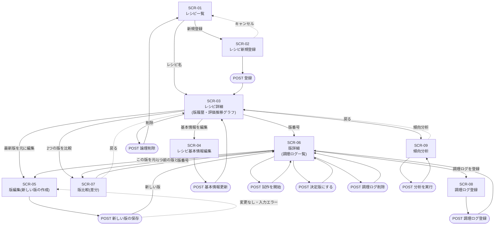
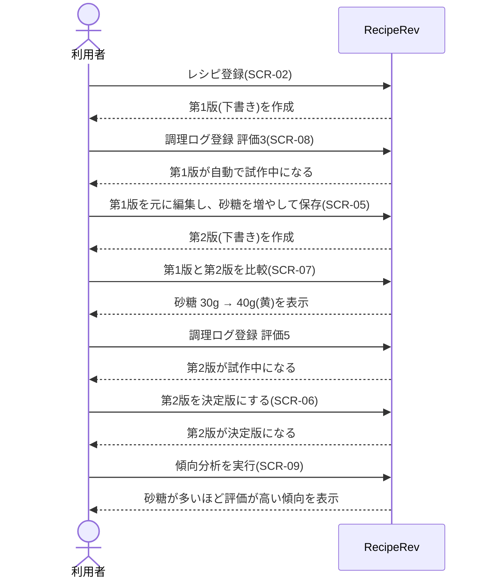

# 03. 画面遷移図 — RecipeRev

関連ドキュメント: [01_要件定義書](01_requirements.md) / [02_画面一覧](02_screens.md) / [04_ER図・テーブル定義](04_er_diagram.md)

---

## 1. 全体の画面遷移

- 四角 = 画面(GET)、角丸 = 更新処理(POST)
- 更新処理の後は、PRGパターンで画面へリダイレクトする

> すべての画面のヘッダーに「RecipeRev」のロゴ(→ SCR-01)とパンくずリストがある。図が見づらくなるため、それらの線は省略している。
> 存在しないID・版番号へのアクセスや、状態遷移のルールに反する操作をすると SCR-99(エラー)を表示する。

---

## 2. 主なシナリオ

### 2.1 配合を改良して決定版を選ぶ(このアプリの中心となる流れ)

### 2.2 決定版を切り替える(BR-05 / BR-06)
1. 第2版が決定版のとき、第4版の SCR-06 で「この版を決定版にする」を押す
2. 確認ダイアログ:「現在の決定版 第2版は試作中に戻ります。よろしいですか?」
3. サーバ側では1トランザクションで、第2版を試作中に、第4版を決定版に更新する
4. フラッシュメッセージ:「第4版を決定版にしました(第2版は試作中に戻りました)」

### 2.3 過去の版からやり直す(BR-02)
1. 第5版の評価が下がったので、評価の良かった第3版の SCR-06 を開く
2. 「この版を元に編集」→ SCR-05 では第3版の内容が入った状態で表示される
3. 保存すると **第6版**(派生元 = 第3版)ができる。第3版の中身は変わらない
