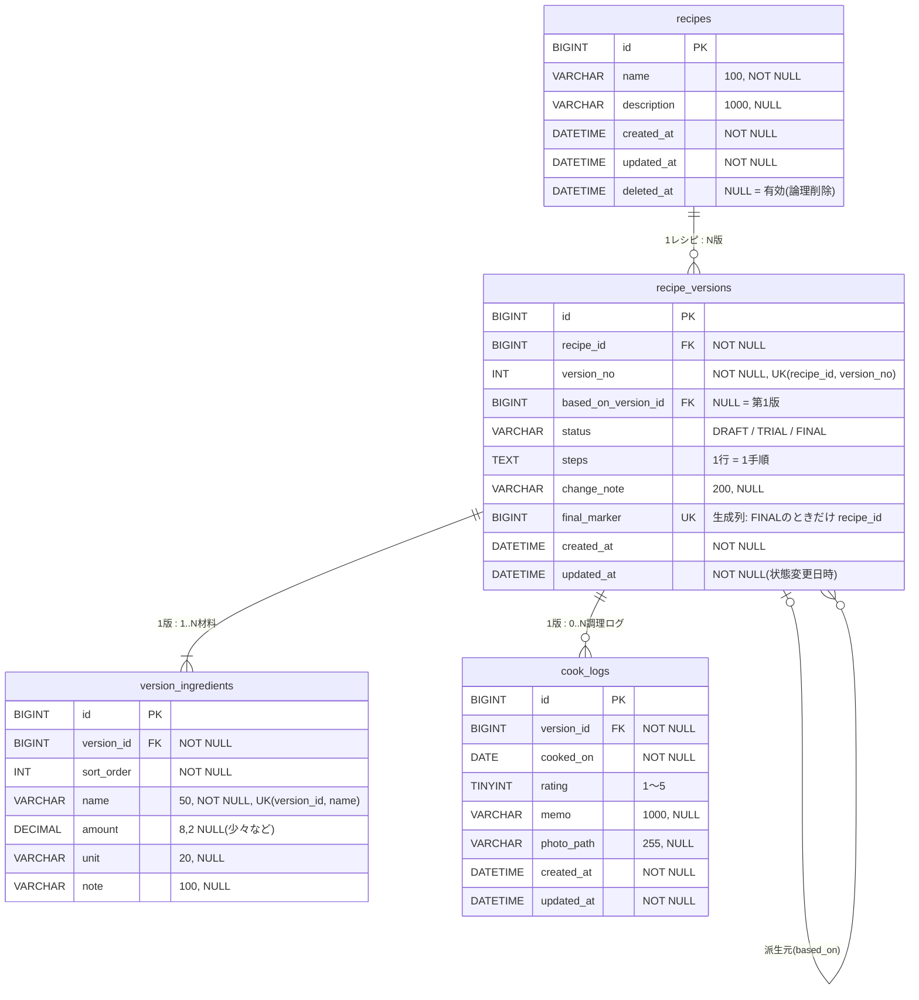

# 04. ER図・テーブル定義 — RecipeRev

関連ドキュメント: [01_要件定義書](01_requirements.md) / [02_画面一覧](02_screens.md) / [03_画面遷移図](03_screen_flow.md)

---

## 1. 設計方針

| 方針 | 理由 |
|---|---|
| 材料・手順は **版(recipe_versions / version_ingredients)が持ち**、レシピ本体は持たない | 版が中身をそのまま丸ごと記録したもの(スナップショット)になるので、過去の版をいつでも正確に再現できる。版どうしの比較もSQLで書ける |
| 版は作った後に変更しない(BR-02) | 変更履歴を改ざんできないようにするため。業務システムのリビジョン管理と同じ考え方 |
| レシピは論理削除(`deleted_at`) | 版と調理ログを消さずに残すため(BR-09) |
| 業務ルールは **アプリとDBの両方** で守る | 版番号の重複(BR-01)と決定版の重複(BR-05)は、アプリにバグがあってもDBの一意制約で止める |
| スキーマは Flyway のマイグレーションで管理する(Phase 2〜) | DDLをバージョン管理する。JPAは `ddl-auto=validate` にして、エンティティとテーブルがずれていないかの確認だけに使う |
| 文字コードは `utf8mb4` | 日本語・絵文字に対応するため |

---

## 2. ER図



---

## 3. テーブル定義

### 3.1 recipes(レシピ本体)

| カラム | 型 | NULL | 既定値 | 説明 |
|---|---|---|---|---|
| id | BIGINT | NO | AUTO_INCREMENT | 主キー |
| name | VARCHAR(100) | NO | | レシピ名 |
| description | VARCHAR(1000) | YES | | 説明 |
| created_at | DATETIME | NO | CURRENT_TIMESTAMP | 作成日時 |
| updated_at | DATETIME | NO | CURRENT_TIMESTAMP ON UPDATE | 更新日時(新しい版を作ったときも更新する) |
| deleted_at | DATETIME | YES | | 論理削除日時。NULL = 有効 |

### 3.2 recipe_versions(版)

| カラム | 型 | NULL | 既定値 | 説明 |
|---|---|---|---|---|
| id | BIGINT | NO | AUTO_INCREMENT | 主キー(内部ID) |
| recipe_id | BIGINT | NO | | FK → recipes.id |
| version_no | INT | NO | | 版番号(レシピ内で1から連番) |
| based_on_version_id | BIGINT | YES | | FK → recipe_versions.id(派生元の版)。第1版は NULL |
| status | VARCHAR(10) | NO | 'DRAFT' | `DRAFT` / `TRIAL` / `FINAL`(CHECK制約) |
| steps | TEXT | NO | | 手順。改行区切りで1行 = 1手順 |
| change_note | VARCHAR(200) | YES | | 変更メモ(例: 砂糖を10g増やした) |
| final_marker | BIGINT | YES | 生成列 | `status = 'FINAL'` のときだけ `recipe_id`、それ以外は NULL |
| created_at | DATETIME | NO | CURRENT_TIMESTAMP | 作成日時 |
| updated_at | DATETIME | NO | CURRENT_TIMESTAMP ON UPDATE | 更新日時(状態を変えたときだけ変わる) |

### 3.3 version_ingredients(版ごとの材料)

| カラム | 型 | NULL | 既定値 | 説明 |
|---|---|---|---|---|
| id | BIGINT | NO | AUTO_INCREMENT | 主キー |
| version_id | BIGINT | NO | | FK → recipe_versions.id |
| sort_order | INT | NO | | 表示順(1から) |
| name | VARCHAR(50) | NO | | 材料名。照合順序は `utf8mb4_bin`(後述) |
| amount | DECIMAL(8,2) | YES | | 分量の数値。「少々」などは NULL |
| unit | VARCHAR(20) | YES | | 単位(g / ml / 大さじ / 個 など) |
| note | VARCHAR(100) | YES | | メモ(少々、室温に戻す など) |

### 3.4 cook_logs(調理ログ)

| カラム | 型 | NULL | 既定値 | 説明 |
|---|---|---|---|---|
| id | BIGINT | NO | AUTO_INCREMENT | 主キー |
| version_id | BIGINT | NO | | FK → recipe_versions.id |
| cooked_on | DATE | NO | | 調理日 |
| rating | TINYINT | NO | | 評価 1〜5(CHECK制約) |
| memo | VARCHAR(1000) | YES | | 味メモ |
| photo_path | VARCHAR(255) | YES | | `uploads/` からの相対パス(ファイル名はUUID) |
| created_at | DATETIME | NO | CURRENT_TIMESTAMP | 作成日時 |
| updated_at | DATETIME | NO | CURRENT_TIMESTAMP ON UPDATE | 更新日時 |

---

## 4. 制約・インデックス

| テーブル | 名前 | 種類 | 対象 | 目的 |
|---|---|---|---|---|
| recipes | PRIMARY | PK | id | |
| recipes | idx_recipes_deleted_updated | INDEX | (deleted_at, updated_at) | 一覧(`WHERE deleted_at IS NULL ORDER BY updated_at DESC`)を速くする |
| recipe_versions | PRIMARY | PK | id | |
| recipe_versions | uk_recipe_versions_recipe_no | UNIQUE | (recipe_id, version_no) | **BR-01** 版番号を重複させない。recipe_id の FK 用インデックスも兼ねる |
| recipe_versions | uk_recipe_versions_final | UNIQUE | (final_marker) | **BR-05** 決定版は1レシピ1件 |
| recipe_versions | fk_recipe_versions_recipe | FK | recipe_id → recipes.id | ON DELETE RESTRICT |
| recipe_versions | fk_recipe_versions_based_on | FK | based_on_version_id → recipe_versions.id | ON DELETE RESTRICT |
| recipe_versions | ck_recipe_versions_status | CHECK | status IN ('DRAFT','TRIAL','FINAL') | 決められた値以外を入れさせない |
| version_ingredients | uk_version_ingredients_name | UNIQUE | (version_id, name) | **BR-11** 版の中で材料名を重複させない。差分は材料名で照合するため必要。FK 用インデックスも兼ねる |
| version_ingredients | fk_version_ingredients_version | FK | version_id → recipe_versions.id | ON DELETE RESTRICT |
| cook_logs | idx_cook_logs_version_cooked | INDEX | (version_id, cooked_on) | 版ごとの調理ログを日付順に取り出す。FK 用インデックスも兼ねる |
| cook_logs | fk_cook_logs_version | FK | version_id → recipe_versions.id | ON DELETE RESTRICT |
| cook_logs | ck_cook_logs_rating | CHECK | rating BETWEEN 1 AND 5 | |

### 4.1 「決定版は1レシピ1件」を生成列で実現する理由
PostgreSQL なら `CREATE UNIQUE INDEX ... WHERE status = 'FINAL'`(条件付きの一意インデックス)で書けるが、**MySQL にはこの機能がない**。そこで次のようにする。

```sql
final_marker BIGINT
    GENERATED ALWAYS AS (CASE WHEN status = 'FINAL' THEN recipe_id END) STORED,
UNIQUE KEY uk_recipe_versions_final (final_marker)
```

- 決定版の行だけ `final_marker = recipe_id` になり、それ以外の行は NULL になる
- UNIQUE 制約は **NULL どうしを重複とみなさない** ため、決定版の行だけが重複チェックの対象になる
- その結果「同じ recipe_id の決定版は2件入れられない」というルールをDBが守る

注意点:
- 生成列の元になっている `recipe_id` に FK を付ける場合、MySQL では `ON DELETE CASCADE` / `SET NULL` を使えない。今回はもともと RESTRICT なので問題ない
- JPA のエンティティでは、この列は `insertable = false, updatable = false` にするか、エンティティに含めない(書き込むのはDBだけ)

### 4.2 決定版を切り替えるときの更新の順番
InnoDB は UNIQUE 制約を **1行更新するごとに** チェックする。そのため、必ず次の順番で更新する。

```sql
-- ① 今の決定版を試作中に戻す(先にやらないと②で一意制約違反になる)
UPDATE recipe_versions SET status = 'TRIAL'
 WHERE recipe_id = :recipeId AND status = 'FINAL';
-- ② 対象の版を決定版にする
UPDATE recipe_versions SET status = 'FINAL'
 WHERE id = :versionId;
```

> JPA は、エンティティへの変更をDBに書き出す(flush)ときに UPDATE の順番を並べ替えることがある。そのため①は一括更新のクエリ(`@Modifying` の JPQL)で実行し、①と②は同じ `@Transactional` の中で処理する(Phase 3 で実装)。

### 4.3 材料名を utf8mb4_bin で照合する理由
MySQL 8 の標準の照合順序 `utf8mb4_0900_ai_ci` は、アクセントや濁点の違いを区別しない場合がある(ai = accent insensitive)。そのため「はちみつ」と「ばちみつ」が同じ文字列とみなされ、一意制約にかかることがある。
差分は Java 側の `String.equals`(完全一致)で材料名を照合するので、DB 側も完全一致の `utf8mb4_bin` に揃える。

### 4.4 版番号の採番
同時に保存したときに版番号が重複しないよう、次の手順で採番する。

```sql
SELECT id FROM recipes WHERE id = :recipeId FOR UPDATE;      -- レシピの行をロックする
SELECT COALESCE(MAX(version_no), 0) + 1 FROM recipe_versions WHERE recipe_id = :recipeId;
INSERT INTO recipe_versions (...) VALUES (...);
```

ロックを取り忘れても、最終的には `uk_recipe_versions_recipe_no` で重複を防げる(DBが最後の防衛線になる)。

---

## 5. 版どうしを比較するSQL(Phase 3〜5 で実装)

### 5.1 2つの版の材料の差分
MySQL には `FULL OUTER JOIN` がないので、まず「両方の版に出てくる材料名の一覧」を作り、それに2つの版を LEFT JOIN する。

```sql
SELECT n.name,
       a.amount AS from_amount, a.unit AS from_unit, a.note AS from_note,
       b.amount AS to_amount,   b.unit AS to_unit,   b.note AS to_note,
       CASE
         WHEN a.id IS NULL THEN 'ADDED'
         WHEN b.id IS NULL THEN 'REMOVED'
         WHEN NOT (a.amount <=> b.amount)
           OR NOT (a.unit   <=> b.unit)
           OR NOT (a.note   <=> b.note) THEN 'CHANGED'
         ELSE 'UNCHANGED'
       END AS change_type
  FROM (SELECT DISTINCT name
          FROM version_ingredients
         WHERE version_id IN (:fromId, :toId)) n
  LEFT JOIN version_ingredients a ON a.version_id = :fromId AND a.name = n.name
  LEFT JOIN version_ingredients b ON b.version_id = :toId   AND b.name = n.name
 ORDER BY COALESCE(b.sort_order, a.sort_order);
```

- `<=>` は **NULLでも正しく比べられる等号**。普通の `=` は `NULL = NULL` の結果が NULL(真にならない)なので、分量が両方とも空欄の材料まで「変更」と判定されてしまう
- 画面に表示する差分は、単体テストしやすいように Java の `RecipeDiffService` で計算する。このSQLは、計算結果が正しいかを結合テストで確かめるときと、学習用に使う

### 5.2 版ごとの平均評価(評価推移グラフ)

```sql
SELECT v.version_no,
       v.status,
       ROUND(AVG(l.rating), 2) AS avg_rating,   -- 調理ログが0件の版は NULL になる
       COUNT(l.id)             AS log_count
  FROM recipe_versions v
  LEFT JOIN cook_logs l ON l.version_id = v.id
 WHERE v.recipe_id = :recipeId
 GROUP BY v.id, v.version_no, v.status
 ORDER BY v.version_no;
```

### 5.3 傾向分析用のCSVを作る(版 × 材料の表)
「調理ログがある版」と「材料名 + 単位の一覧」の全組み合わせ(CROSS JOIN)を作り、その版に入っていない材料は分量0にする。

```sql
WITH rated AS (                        -- 調理ログがある版と、その平均評価
  SELECT v.id AS version_id, v.version_no, AVG(l.rating) AS avg_rating
    FROM recipe_versions v
    JOIN cook_logs l ON l.version_id = v.id
   WHERE v.recipe_id = :recipeId
   GROUP BY v.id, v.version_no
),
keys AS (                              -- 分析する「材料名 + 単位」の一覧
  SELECT DISTINCT i.name, i.unit
    FROM version_ingredients i
    JOIN rated r ON r.version_id = i.version_id
   WHERE i.amount IS NOT NULL
)
SELECT r.version_no, k.name, k.unit,
       COALESCE(i.amount, 0) AS amount,  -- その版に入っていない材料は0として扱う
       r.avg_rating
  FROM rated r
 CROSS JOIN keys k
  LEFT JOIN version_ingredients i
         ON i.version_id = r.version_id
        AND i.name = k.name
        AND i.unit <=> k.unit
 WHERE i.id IS NULL OR i.amount IS NOT NULL  -- 材料はあるが分量が空欄(少々など)の行は除く
 ORDER BY k.name, k.unit, r.version_no;
```

- 単位が違う同じ材料(例: 砂糖 g と 砂糖 大さじ)は別の材料として扱う(単位の換算はスコープ外)
- 複雑な集計なので、JPA ではなく `JdbcTemplate` で実行する

---

## 6. DDL(案)

Phase 2 で Flyway の `V1__create_tables.sql` として実際に作る。

```sql
CREATE TABLE recipes (
    id          BIGINT        NOT NULL AUTO_INCREMENT,
    name        VARCHAR(100)  NOT NULL,
    description VARCHAR(1000) NULL,
    created_at  DATETIME      NOT NULL DEFAULT CURRENT_TIMESTAMP,
    updated_at  DATETIME      NOT NULL DEFAULT CURRENT_TIMESTAMP ON UPDATE CURRENT_TIMESTAMP,
    deleted_at  DATETIME      NULL,
    PRIMARY KEY (id),
    INDEX idx_recipes_deleted_updated (deleted_at, updated_at)
) ENGINE = InnoDB DEFAULT CHARSET = utf8mb4 COLLATE = utf8mb4_0900_ai_ci;

CREATE TABLE recipe_versions (
    id                  BIGINT       NOT NULL AUTO_INCREMENT,
    recipe_id           BIGINT       NOT NULL,
    version_no          INT          NOT NULL,
    based_on_version_id BIGINT       NULL,
    status              VARCHAR(10)  NOT NULL DEFAULT 'DRAFT',
    steps               TEXT         NOT NULL,
    change_note         VARCHAR(200) NULL,
    final_marker        BIGINT GENERATED ALWAYS AS (CASE WHEN status = 'FINAL' THEN recipe_id END) STORED,
    created_at          DATETIME     NOT NULL DEFAULT CURRENT_TIMESTAMP,
    updated_at          DATETIME     NOT NULL DEFAULT CURRENT_TIMESTAMP ON UPDATE CURRENT_TIMESTAMP,
    PRIMARY KEY (id),
    UNIQUE KEY uk_recipe_versions_recipe_no (recipe_id, version_no),
    UNIQUE KEY uk_recipe_versions_final (final_marker),
    CONSTRAINT fk_recipe_versions_recipe   FOREIGN KEY (recipe_id)           REFERENCES recipes (id),
    CONSTRAINT fk_recipe_versions_based_on FOREIGN KEY (based_on_version_id) REFERENCES recipe_versions (id),
    CONSTRAINT ck_recipe_versions_status   CHECK (status IN ('DRAFT', 'TRIAL', 'FINAL'))
) ENGINE = InnoDB DEFAULT CHARSET = utf8mb4 COLLATE = utf8mb4_0900_ai_ci;

CREATE TABLE version_ingredients (
    id         BIGINT        NOT NULL AUTO_INCREMENT,
    version_id BIGINT        NOT NULL,
    sort_order INT           NOT NULL,
    name       VARCHAR(50)   CHARACTER SET utf8mb4 COLLATE utf8mb4_bin NOT NULL,
    amount     DECIMAL(8, 2) NULL,
    unit       VARCHAR(20)   NULL,
    note       VARCHAR(100)  NULL,
    PRIMARY KEY (id),
    UNIQUE KEY uk_version_ingredients_name (version_id, name),
    CONSTRAINT fk_version_ingredients_version FOREIGN KEY (version_id) REFERENCES recipe_versions (id)
) ENGINE = InnoDB DEFAULT CHARSET = utf8mb4 COLLATE = utf8mb4_0900_ai_ci;

CREATE TABLE cook_logs (
    id         BIGINT        NOT NULL AUTO_INCREMENT,
    version_id BIGINT        NOT NULL,
    cooked_on  DATE          NOT NULL,
    rating     TINYINT       NOT NULL,
    memo       VARCHAR(1000) NULL,
    photo_path VARCHAR(255)  NULL,
    created_at DATETIME      NOT NULL DEFAULT CURRENT_TIMESTAMP,
    updated_at DATETIME      NOT NULL DEFAULT CURRENT_TIMESTAMP ON UPDATE CURRENT_TIMESTAMP,
    PRIMARY KEY (id),
    INDEX idx_cook_logs_version_cooked (version_id, cooked_on),
    CONSTRAINT fk_cook_logs_version FOREIGN KEY (version_id) REFERENCES recipe_versions (id),
    CONSTRAINT ck_cook_logs_rating  CHECK (rating BETWEEN 1 AND 5)
) ENGINE = InnoDB DEFAULT CHARSET = utf8mb4 COLLATE = utf8mb4_0900_ai_ci;
```

> FK の ON DELETE を省略すると RESTRICT(参照されている行は削除できない)になる。
> `recipe_versions.updated_at` は ON UPDATE で自動更新されるが、版の更新は状態変更だけ(BR-02)なので「状態を変えた日時」という意味になる。
